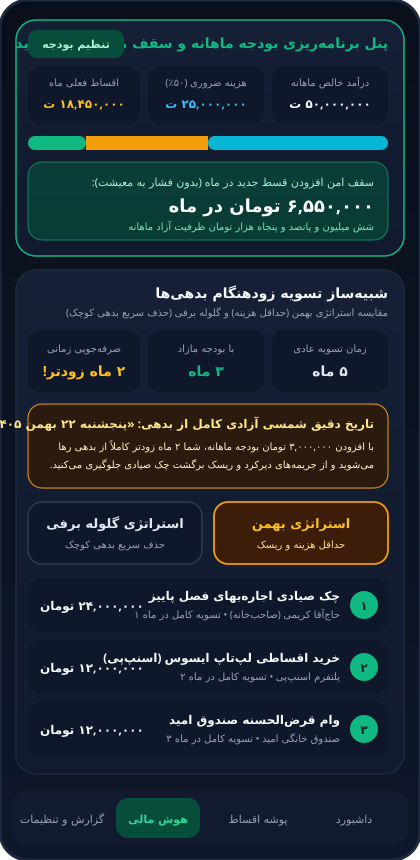
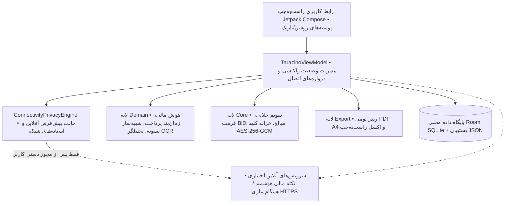

<div dir="rtl" align="right">

<p align="center">
  
</p>

<h1 align="center">ترازینو (<bdi dir="ltr">Tarazino</bdi>)</h1>

<p align="center">
  <strong>سامانه بومی، راست‌به‌چپ و آفلاین‌پایه برای مدیریت هوشمند اقساط، وام‌های بانکی، خریدهای اعتباری، چک‌های صیادی و بودجه‌ریزی شخصی در اندروید</strong>
</p>

<p align="center">
  <a href="../../releases/latest"></a>
  <a href="../../releases/latest"></a>
  <a href="../../releases"></a>
  <a href="#security-privacy"></a>
</p>

---

## 📖 فهرست مطالب

- [معرفی پروژه](#overview)
- [قابلیت‌های کلیدی](#features)
- [نمای محیط‌های برنامه](#screenshots)
- [پشته فناوری و معماری](#architecture)
- [ساختار دایرکتوری پروژه](#structure)
- [پیش‌نیازها، ساخت و اجرای تست‌ها](#build-test)
- [امنیت و معماری آفلاین‌پیشه](#security-privacy)
- [نسخه‌ها و دریافت فایل نصبی](#releases)

---

<a id="overview"></a>

## 🔍 معرفی پروژه

**ترازینو (<bdi dir="ltr">Tarazino</bdi>)** یک اپلیکیشن بومی اندروید است که برای حل مشکل پراکندگی اقساط، وام‌های بانکی، خریدهای اعتباری (<bdi dir="ltr">BNPL</bdi> مانند اسنپ‌پی و دیجی‌پی)، صندوق‌های خانگی و چک‌های صیادی در زیست‌بوم مالی ایران طراحی شده است.

بسیاری از ابزارهای مالی عمومی با فرم‌های شلوغ، تاریخ میلادی یا اجبار به ذخیره‌سازی ابری طراحی شده‌اند؛ در مقابل، ترازینو بر چهار اصل مهندسی بنا شده است:

1. **آفلاین‌پیشه و حریم خصوصی کامل:** پایگاه داده اصلی برنامه به‌صورت محلی (<bdi dir="ltr">Room SQLite</bdi>) روی دستگاه کاربر نگهداری می‌شود و تمامی قابلیت‌های نیازمند اینترنت به‌صورت پیش‌فرض غیرفعال هستند.
2. **تقویم شمسی دقیق و دقت محاسباتی عدد صحیح:** استفاده از تقویم جلالی با چرخه کبیسه ۳۳ ساله، نمایش حروفی مبالغ فارسی، جداسازی ارقام با کاراکترهای استاندارد <bdi dir="ltr">BiDi</bdi> و محاسبه تمام مبالغ بر پایه اعداد صحیح ۶۴ بیتی (<bdi dir="ltr">Long</bdi>) بدون خطای اعشار.
3. **ساختار درختی و داشبورد ماژولار:** دسته‌بندی بدهی‌ها و مطالبات در پوشه‌های مشخص به جای لیست‌های تودرتو، همراه با امکان تغییر اولویت و چیدمان ماژول‌های داشبورد.
4. **آماده برای کاربردهای رسمی:** تولید مستقیم فایل <bdi dir="ltr">PDF</bdi> رنگی استاندارد <bdi dir="ltr">A4</bdi> و خروجی اکسل راست‌به‌چپ برای بایگانی یا ارائه به طرف‌حساب‌ها.

---

<a id="features"></a>

## ✨ قابلیت‌های کلیدی

- **مدیریت درختی تعهدات و طرف‌حساب‌ها:** سازماندهی بدهی‌ها و مطالبات در ۴ دسته اصلی (خریدهای اقساطی، بانک‌ها و تسهیلات، صندوق‌های خانگی و اشخاص/چک‌های صیادی)، ذخیره شماره کارت و شبا، ویرایش سریع پرونده و تسویه گروهی هم‌زمان چند قسط.
- **اسکنر هوشمند قرارداد وام و رسید (<bdi dir="ltr">CameraX + ML Kit OCR</bdi>):** استخراج خودکار مبلغ قسط، تاریخ سررسید شمسی و نرخ سود از روی برگه‌های کاغذی به‌صورت آفلاین روی دستگاه برای ثبت وام جدید یا تسویه قسط.
- **داشبورد فرماندهی ماژولار (<bdi dir="ltr">Reorderable Grid</bdi>):** جابه‌جایی، پین کردن و نمایش/مخفی‌سازی کارت‌هایی مانند «رادار سلامت مالی ۵ بُعدی»، «ردیاب گلوله برفی بدهی»، «نمودار حلقه‌ای دسته‌ها» و «نکته مالی روزانه».
- **موتور هوش مالی آفلاین و زمان‌بند پرداخت:** تحلیل نسبت بدهی به درآمد (<bdi dir="ltr">DTI</bdi>)، محاسبه سقف ایمن قسط جدید ماهانه، تقویم حرارتی سررسیدها، شبیه‌ساز مقایسه استراتژی‌های «بهمن» و «گلوله برفی» و پیشنهاد بهترین روزهای پرداخت ماه بر اساس چرخه درآمدی.
- **مرکز متمرکز «اتصال و حریم خصوصی»:** فعال‌سازی دستی و انتخابی قابلیت‌های آنلاین (نکته مالی هوشمند یا همگام‌سازی ابری روی سرور شخصی)، ورود کلید <bdi dir="ltr">API</bdi> یا آدرس سرور <bdi dir="ltr">HTTPS</bdi> توسط کاربر، محدودیت اجرا فقط روی وای‌فای، سهمیه روزانه و ناشناس‌سازی داده‌ها.
- **گزارش‌گیری و چاپ رسمی <bdi dir="ltr">A4</bdi> و اکسل:** تولید بومی برگه <bdi dir="ltr">PDF</bdi> رنگی با فونت فارسی، خروجی اکسل راست‌به‌چپ (<bdi dir="ltr">.xls</bdi>) و فایل <bdi dir="ltr">.csv</bdi> مجهز به <bdi dir="ltr">UTF-8 BOM</bdi>.
- **شخصی‌سازی پوسته، ویجت و خزانه امنیتی:** سوئیچ آنی بین پوسته روشن «فیروزه تیره» و پوسته «تاریک پُرکنتراست شبانه» (در مجموع ۷ پوسته)، مقیاس فونت، ویجت ثبت سریع صفحه اصلی، قفل پین <bdi dir="ltr">SHA-256</bdi>، بیومتریک و جلوگیری از اسکرین‌شات (<bdi dir="ltr">FLAG_SECURE</bdi>).

---

<a id="screenshots"></a>

## 📱 نمای محیط‌های برنامه

### ۱. داشبورد ماژولار و پوشه درختی اقساط + اسکنر <bdi dir="ltr">OCR</bdi>

<table width="100%" dir="rtl">
  <thead>
    <tr>
      <th width="50%" align="center">داشبورد چیدمان‌پذیر، رادار سلامت و گلوله برفی</th>
      <th width="50%" align="center">پوشه درختی طرف‌پرداخت و اسکنر قرارداد <bdi dir="ltr">OCR</bdi></th>
    </tr>
  </thead>
  <tbody>
    <tr>
      <td align="center">
        
      </td>
      <td align="center">
        
      </td>
    </tr>
    <tr>
      <td align="right">
        کارت خلاصه ماه جاری با نمایش دقیق «میلیون» و «میلیارد»، ماژول‌های قابل اولویت‌بندی داشبورد، نمودار رادار سلامت مالی، ردیاب گلوله برفی و کارت آفلاین نکته مالی.
      </td>
      <td align="right">
        تفکیک ۴گانه طرف‌حساب‌ها همراه با فیلتر و تسویه گروهی اقساط و اسکنر دوربین آفلاین برای خواندن خودکار قراردادهای بانکی و رسیدها.
      </td>
    </tr>
  </tbody>
</table>

### ۲. هوش مالی و زمان‌بند، مرکز اتصال و حریم خصوصی، پوسته شب/روز و چاپ <bdi dir="ltr">A4</bdi>

<table width="100%" dir="rtl">
  <thead>
    <tr>
      <th width="33%" align="center">زمان‌بند خودکار و شبیه‌ساز تسویه</th>
      <th width="33%" align="center">تنظیمات اتصال و حریم خصوصی</th>
      <th width="33%" align="center">پوسته‌های شب/روز و گزارش <bdi dir="ltr">A4</bdi></th>
    </tr>
  </thead>
  <tbody>
    <tr>
      <td align="center">
        
      </td>
      <td align="center">
        
      </td>
      <td align="center">
        
      </td>
    </tr>
    <tr>
      <td align="right">
        پیشنهاد بهترین روز پرداخت ماه بر اساس چرخه درآمد، پیش‌بینی نقدینگی و مقایسه استراتژی‌های بهمن و گلوله برفی.
      </td>
      <td align="right">
        مدیریت حالت پیش‌فرض آفلاین، فعال‌سازی دستی سرویس‌های اینترنتی، ورود کلید و آدرس سرور <bdi dir="ltr">HTTPS</bdi>، محدودیت وای‌فای و محافظت صفحه.
      </td>
      <td align="right">
        سوئیچ میان پوسته روشن فیروزه تیره و تاریک پُرکنتراست شبانه و خروجی مستقیم <bdi dir="ltr">PDF</bdi> رنگی <bdi dir="ltr">A4</bdi> و اکسل راست‌به‌چپ.
      </td>
    </tr>
  </tbody>
</table>

---

<a id="architecture"></a>

## 🛠️ پشته فناوری و معماری

پروژه از الگوی معماری لایه‌بندی‌شده (<bdi dir="ltr">Clean Architecture / MVVM</bdi>) پیروی می‌کند و منطق مالی، تقویم و قوانین حریم خصوصی به‌صورت خالص (<bdi dir="ltr">Pure Kotlin</bdi>) در لایه <bdi dir="ltr">domain</bdi> و <bdi dir="ltr">core</bdi> ایزوله شده‌اند.

<table width="100%" dir="rtl">
  <thead>
    <tr>
      <th align="right">لایه</th>
      <th align="right">فناوری‌ها و ابزارها</th>
      <th align="right">مسئولیت</th>
    </tr>
  </thead>
  <tbody>
    <tr>
      <td align="right"><strong>رابط کاربری (<bdi dir="ltr">UI</bdi>)</strong></td>
      <td align="right"><bdi dir="ltr">Kotlin, Jetpack Compose, Material 3, Vazirmatn</bdi></td>
      <td align="right">صفحات راست‌به‌چپ واکنشی، ۷ پوسته، انیمیشن‌ها، ویجت صفحه اصلی و پیش‌نمایش <bdi dir="ltr">A4</bdi></td>
    </tr>
    <tr>
      <td align="right"><strong>بینایی ماشین و دوربین</strong></td>
      <td align="right"><bdi dir="ltr">CameraX, Google ML Kit Text Recognition</bdi></td>
      <td align="right">اسکن قراردادها و استخراج مبلغ، تاریخ و نرخ سود به‌صورت آفلاین روی دستگاه</td>
    </tr>
    <tr>
      <td align="right"><strong>منطق و هسته (<bdi dir="ltr">Core / Domain</bdi>)</strong></td>
      <td align="right"><bdi dir="ltr">Pure Kotlin, Coroutines, StateFlow</bdi></td>
      <td align="right">تقویم جلالی، حروف‌نگار مبالغ، تحلیل <bdi dir="ltr">DTI</bdi>، زمان‌بند خودکار، قوانین آفلاین/آنلاین</td>
    </tr>
    <tr>
      <td align="right"><strong>ذخیره‌سازی و امنیت</strong></td>
      <td align="right"><bdi dir="ltr">Room SQLite, Android Keystore AES-256-GCM, BiometricPrompt</bdi></td>
      <td align="right">ذخیره‌سازی محلی، رمزنگاری کلیدهای کاربر، قفل پین <bdi dir="ltr">SHA-256</bdi> و پشتیبان <bdi dir="ltr">JSON</bdi></td>
    </tr>
    <tr>
      <td align="right"><strong>سرویس‌های آنلاین اختیاری</strong></td>
      <td align="right"><bdi dir="ltr">Firebase AI Logic (App Check) / Custom HTTPS REST</bdi></td>
      <td align="right">نکته مالی روزانه و همگام‌سازی ابری شخصی (فقط در صورت فعال‌سازی دستی کاربر)</td>
    </tr>
    <tr>
      <td align="right"><strong>گزارش‌سازی و تست</strong></td>
      <td align="right"><bdi dir="ltr">Android PdfDocument, JUnit 4, Robolectric</bdi></td>
      <td align="right">تولید <bdi dir="ltr">PDF</bdi> رنگی، اکسل <bdi dir="ltr">XLS/CSV</bdi> و تست‌های خودکار واحد</td>
    </tr>
  </tbody>
</table>



---

<a id="structure"></a>

## 📂 ساختار دایرکتوری پروژه

<div dir="ltr" align="left">

```text
├── .github/workflows/
│   └── release-apk.yml                # پایپ‌لاین خودکار ساخت و انتشار ریلیز در GitHub Releases
├── docs/screenshots/                  # تصاویر و نمودارهای محیط‌های مختلف برنامه
├── releases/                          # خروجی بسته‌های نصبی و فایل‌های SHA-256 هر نسخه
├── app/
│   ├── build.gradle.kts               # پیکربندی ماژول اندروید، نسخه و وابستگی‌ها
│   └── src/
│       ├── main/java/com/example/
│       │   ├── MainActivity.kt        # نقطه ورود، کنترل FLAG_SECURE و ناوبری اصلی
│       │   ├── ai/                    # سرویس‌های آنلاین اختیاری (AI Tip و همگام‌سازی HTTPS)
│       │   ├── core/                  # تقویم جلالی، حروف‌نگار مبالغ، رمزنگاری Keystore و پین
│       │   ├── data/                  # موجودیت‌ها، DAO، دیتابیس Room و مخزن داده
│       │   ├── domain/                # منطق خالص اقساط، هوش مالی، زمان‌بند، OCR و حریم خصوصی
│       │   ├── export/                # موتور خروجی PDF A4، اکسل راست‌به‌چپ و CSV
│       │   ├── notification/          # یادآورهای پس‌زمینه اقساط با WorkManager
│       │   ├── ui/                    # ViewModel، صفحات، کامپوننت‌ها و سیستم پوسته
│       │   └── widget/                # ویجت ثبت سریع صفحه اصلی اندروید
│       └── test/java/com/example/     # تست‌های واحد (Unit Tests) برای هسته و منطق مالی
├── gradle/libs.versions.toml          # کاتالوگ متمرکز نسخه کتابخانه‌ها
├── RELEASE_NOTES_v0.2.md              # شرح تغییرات نسخه ۰.۲ برای صفحه Releases
└── RELEASE_NOTES_v0.1.md              # شرح تغییرات نسخه ۰.۱
```

</div>

---

<a id="build-test"></a>

## ⚙️ پیش‌نیازها، ساخت و اجرای تست‌ها

### پیش‌نیازها

- <bdi dir="ltr">JDK 17</bdi>
- <bdi dir="ltr">Android SDK (API Level 36, minSdk 24)</bdi>
- <bdi dir="ltr">Gradle 9.3.1</bdi>

### ساخت بسته نصبی اندروید

<div dir="ltr" align="left">

```bash
# اطمینان از وجود keystore برای امضای بیلد دیباگ (در محیط‌های کلون‌شده)
base64 -d debug.keystore.base64 > debug.keystore

# ساخت فایل APK
gradle assembleDebug
```

</div>

فایل خروجی در مسیر زیر تولید می‌شود:
<bdi dir="ltr"><code>app/build/outputs/apk/debug/app-debug.apk</code></bdi>

### اجرای تست‌های واحد

<div dir="ltr" align="left">

```bash
gradle :app:testDebugUnitTest \
  --tests "com.example.core.*" \
  --tests "com.example.domain.*" \
  --tests "com.example.ui.theme.*" \
  --tests "com.example.export.*" \
  --tests "com.example.widget.*"
```

</div>

---

<a id="security-privacy"></a>

## 🔒 امنیت و معماری آفلاین‌پیشه

- **حالت پیش‌فرض بدون اینترنت:** بلافاصله پس از نصب، تمامی اتصالات خروجی (شامل تحلیل هوشمند آنلاین و همگام‌سازی ابری) در وضعیت `Disabled` قرار دارند و هیچ داده‌ای از گوشی خارج نمی‌شود.
- **جداسازی و رمزنگاری کلیدهای کاربر:** کلیدهای <bdi dir="ltr">API</bdi> و توکن‌های همگام‌سازی ابری که کاربر به‌صورت اختیاری وارد می‌کند، با کلید سخت‌افزاری <bdi dir="ltr">Android Keystore (AES-256-GCM)</bdi> رمزنگاری شده و هرگز در فایل‌های خروجی پشتیبان <bdi dir="ltr">JSON</bdi> قرار نمی‌گیرند.
- **اعتبارسنجی امن نشانی‌ها:** برای سرورهای اختصاصی تنها پروتکل رمزنگاری‌شده <bdi dir="ltr">HTTPS</bdi> پذیرفته می‌شود و آدرس‌های محلی یا شبکه خصوصی مسدود می‌گردند.
- **کنترل‌های فیزیکی و محیطی:** پشتیبانی از قفل پین هش‌شده (<bdi dir="ltr">SHA-256</bdi>)، ورود بیومتریک، مسدودسازی اسکرین‌شات و نمای برنامه‌های اخیر (<bdi dir="ltr">FLAG_SECURE</bdi>) و مخفی‌سازی مبالغ در محیط برنامه و ویجت.

---

<a id="releases"></a>

## 📦 نسخه‌ها و دریافت فایل نصبی

برای دریافت فایل نصبی آماده (<bdi dir="ltr">APK</bdi>)، بررسی کد کنترلی <bdi dir="ltr">SHA-256</bdi> و مطالعه تاریخچه تغییرات هر نسخه، به بخش رسمی انتشارهای مخزن مراجعه کنید:

- 👉 **[مشاهده و دانلود از صفحه <bdi dir="ltr">Releases</bdi> گیت‌هاب](../../releases)**
- 📄 شرح کامل تغییرات هر نسخه در مستندات منتشرشده کنار همان نسخه از جمله <a href="./RELEASE_NOTES_v0.2.md"><bdi dir="ltr"><code>RELEASE_NOTES_v0.2.md</code></bdi></a> و <a href="./RELEASE_NOTES_v0.1.md"><bdi dir="ltr"><code>RELEASE_NOTES_v0.1.md</code></bdi></a> ثبت شده است.

</div>
