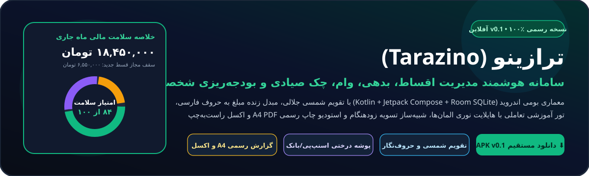
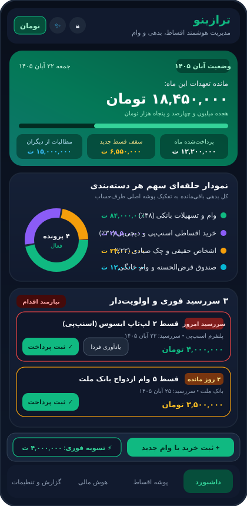
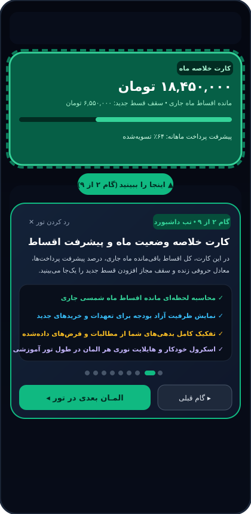
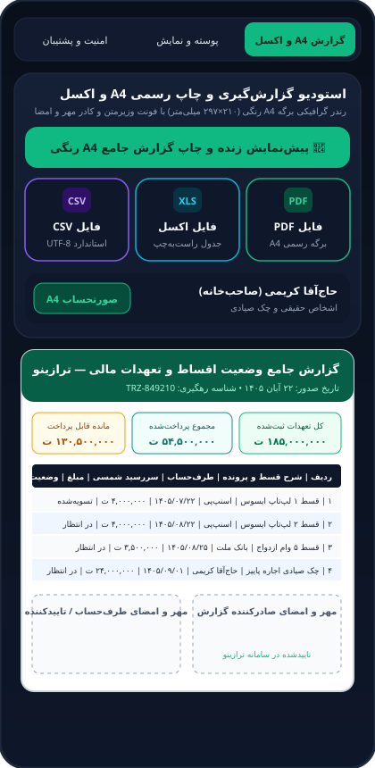

<div dir="rtl" align="right">

<p align="center">
  
</p>

<h1 align="center">ترازینو (Tarazino) — نسخه رسمی <code>v0.1</code></h1>
<h3 align="center">سامانه جامع، بومی و ۱۰۰٪ آفلاین مدیریت اقساط، بدهی، وام بانکی، پلتفرم‌های خرید اعتباری (اسنپ‌پی/دیجی‌پی)، چک صیادی و هوش مالی شخصی</h3>

---

## 📥 دانلود مستقیم فایل نصبی اندروید (`Tarazino-v0.1.apk`)

فایل نصبی کامپایل‌شده و امضاشده نسخه **`0.1`** هم در پوشه [`/releases/Tarazino-v0.1.apk`](./releases/Tarazino-v0.1.apk) داخل مخزن قرار داده شده است و هم از طریق بخش **Releases** گیت‌هاب قابل دریافت مستقیم است:

<table width="100%" dir="rtl">
  <thead>
    <tr>
      <th align="right">روش دریافت</th>
      <th align="right">توضیحات</th>
      <th align="center">لینک دانلود مستقیم</th>
    </tr>
  </thead>
  <tbody>
    <tr>
      <td align="right"><strong>۱. دانلود مستقیم و فوری از مخزن (بدون انتظار)</strong></td>
      <td align="right">فایل نصبی نهایی <code>Tarazino-v0.1.apk</code> (حجم ۱۹ مگابایت • اندروید ۷.۰ به بالا) مستقیماً در پوشه <code>releases/</code> مخزن قرار دارد.</td>
      <td align="center"><a href="./releases/Tarazino-v0.1.apk"><strong>⬇ دانلود مستقیم Tarazino-v0.1.apk</strong></a></td>
    </tr>
    <tr>
      <td align="right"><strong>۲. دانلود از بخش Releases گیت‌هاب</strong></td>
      <td align="right">دریافت از صفحه رسمی انتشار (GitHub Releases) همراه با یادداشت‌های نسخه <code>v0.1</code> و فایل چک‌سام <code>SHA-256</code>.</td>
      <td align="center"><a href="../../releases/latest/download/Tarazino-v0.1.apk"><strong>📦 صفحه Releases (نسخه v0.1)</strong></a></td>
    </tr>
    <tr>
      <td align="right"><strong>۳. کنترل سلامت فایل نصبی (SHA-256)</strong></td>
      <td align="right">فایل هش استاندارد جهت اطمینان از صحت کامل بسته نصبی دانلودشده.</td>
      <td align="center"><a href="./releases/Tarazino-v0.1.apk.sha256"><strong>🔐 مشاهده SHA-256</strong></a></td>
    </tr>
  </tbody>
</table>

> **💡 نکته مهم درباره بخش Releases گیت‌هاب:**  
> فایل نصبی آماده **`releases/Tarazino-v0.1.apk`** اکنون مستقیماً در مخزن قرار گرفته و پایپ‌لاین خودکار [`.github/workflows/release-apk.yml`](./.github/workflows/release-apk.yml) به گونه‌ای بهینه‌سازی شده است که بدون نیاز به دانلود SDK سنگین روی سرور گیت‌هاب، در **کمتر از ۱۰ ثانیه** پس از **Push to GitHub**، ریلیز رسمی **`v0.1`** را در قسمت **Releases** مخزن ثبت می‌کند. (در صورتی که در مخزن تازه ساخته‌شده، تب Actions نیاز به تایید اولیه داشت، کافی است یک بار وارد تب **Actions** شده و روی **Run workflow** کلیک کنید تا ریلیز `v0.1` بلافاصله در ستون سمت راست صفحه اصلی ظاهر شود).

---

## 🌟 معرفی و ارزش پیشنهادی ترازینو (Overview & Presentation)

**ترازینو (Tarazino)** یک دستیار مالی شخصی نسل جدید است که به صورت اختصاصی برای زیست‌بوم مالی ایران و کاربران فارسی‌زبان طراحی و مهندسی شده است. برخلاف برنامه‌های عمومی حسابداری که فضای شلوغ و گیج‌کننده‌ای دارند، ترازینو با **ساختار درختی هوشمند بر اساس طرف‌پرداخت**، **تقویم ۱۰۰٪ شمسی (جلالی)**، **مبدل زنده عدد به حروف فارسی** و **هوش مالی آفلاین** به شما کمک می‌کند تمام تعهدات مالی خود را در یک نگاه مدیریت کنید:

- **حفظ کامل حریم خصوصی و اجرای ۱۰۰٪ آفلاین:** تمامی داده‌ها در پایگاه داده محلی دستگاه (`Room SQLite`) ذخیره می‌شوند و هیچ اطلاعاتی به سرورهای ابری ارسال نمی‌گردد.
- **سازماندهی درختی و خلوت بر اساس ماهیت طرف‌حساب:** دسته‌بندی تعهدات در ۴ پوشه اصلی (**پلتفرم‌های خرید اقساطی مانند اسنپ‌پی و دیجی‌پی**، **وام و تسهیلات بانکی**، **صندوق‌های قرض‌الحسنه و وام خانگی**، و **اشخاص حقیقی و چک‌های صیادی**).
- **دقت ریاضی مطلق (بدون خطای گرد کردن):** محاسبه تمام اقساط با اعداد صحیح ۶۴ بیتی (`Long`) و تخصیص هوشمند باقی‌مانده تقسیم به قسط آخر، همراه با پشتیبانی آنی از دو واحد **تومان** و **ریال**.

---

## 📱 گالری تصاویر و نمای محیط‌های مختلف برنامه (Visual Screen Gallery)

### ۱. داشبورد فرماندهی ماهانه و پوشه درختی اقساط (اسنپ‌پی، دیجی‌پی و بانک‌ها)

<table width="100%" dir="rtl">
  <thead>
    <tr>
      <th width="50%" align="center">نمای داشبورد هوشمند، نمودار حلقه‌ای و ۳ سررسید فوری</th>
      <th width="50%" align="center">پوشه درختی اقساط، فیلتر هوشمند و تسویه گروهی چند قسط</th>
    </tr>
  </thead>
  <tbody>
    <tr>
      <td align="center">
        
      </td>
      <td align="center">
        
      </td>
    </tr>
    <tr>
      <td align="right">
        <ul>
          <li><strong>کارت خلاصه وضعیت ماه جاری:</strong> نمایش مجموع اقساط باقی‌مانده ماه، نوار پیشرفت پرداخت‌ها، معادل حروفی زنده و <strong>سقف مجاز قسط جدید</strong>.</li>
          <li><strong>نمودار حلقه‌ای (Donut Chart):</strong> نمایش گرافیکی سهم هر دسته‌بندی از کل بدهی‌ها.</li>
          <li><strong>رادار ۳ سررسید فوری:</strong> ثبت پرداخت تک‌کلیکی و یادآوری فردا (<code>Snooze</code>).</li>
          <li><strong>نوار اقدام سریع شناور:</strong> دسترسی دائمی در پایین تمام صفحات برای ثبت وام/خرید جدید یا تسویه فوری‌ترین قسط.</li>
        </ul>
      </td>
      <td align="right">
        <ul>
          <li><strong>مسیر راهنمای درختی (Breadcrumb):</strong> حرکت روان از دسته اصلی به زیرمجموعه (مانند اسنپ‌پی یا بانک ملت) و مشاهده ریز اقساط هر خرید.</li>
          <li><strong>تسویه گروهی چند قسط با هم:</strong> انتخاب هم‌زمان چندین قسط با چک‌باکس، مشاهده جمع کل به عدد و حروف فارسی و تسویه یک‌جا با یک کلیک.</li>
          <li><strong>ویرایش سریع مشخصات پرونده وام:</strong> تغییر عنوان، مبلغ، شماره قرارداد و یادداشت بدون نیاز به حذف پرونده.</li>
          <li><strong>مرتب‌سازی و فیلتر هوشمند:</strong> فیلتر بر اساس وضعیت (همه، پرداخت‌نشده، معوقه، تسویه‌شده) و مرتب‌سازی بر اساس فوریت سررسید یا مبلغ.</li>
        </ul>
      </td>
    </tr>
  </tbody>
</table>

---

### ۲. مرکز هوش مالی آفلاین، تور آموزشی تعاملی و استودیو چاپ رسمی A4

<table width="100%" dir="rtl">
  <thead>
    <tr>
      <th width="33%" align="center">برنامه‌ریزی بودجه و شبیه‌ساز تسویه</th>
      <th width="33%" align="center">تور آموزشی با هایلایت نوری المان‌ها</th>
      <th width="33%" align="center">استودیو گزارش رسمی A4 و اکسل</th>
    </tr>
  </thead>
  <tbody>
    <tr>
      <td align="center">
        
      </td>
      <td align="center">
        
      </td>
      <td align="center">
        
      </td>
    </tr>
    <tr>
      <td align="right">
        <ul>
          <li><strong>پنل برنامه‌ریزی بودجه ماهانه:</strong> تنظیم درآمد و درصد هزینه‌های ضروری زندگی و محاسبه خودکار <strong>«سقف امن افزودن قسط جدید در ماه»</strong>.</li>
          <li><strong>شبیه‌ساز متقارن تسویه زودهنگام:</strong> مقایسه دو استراتژی <strong>بهمن (حداقل هزینه و ریسک)</strong> و <strong>گلوله برفی (حذف سریع بدهی کوچک)</strong> همراه با تاریخ دقیق شمسی آزادی کامل از بدهی.</li>
        </ul>
      </td>
      <td align="right">
        <ul>
          <li><strong>پنجره نوری مختصات‌محور (Spotlight Cutout):</strong> تاریک کردن صفحه و روشن نگه داشتن دقیق المان یا دکمه هدف در ۹ گام آموزشی.</li>
          <li><strong>نشانگر گرافیکی متحرک و اسکرول خودکار:</strong> حرکت خودکار بین تب‌ها، اسکرول به المان هدف و نمایش کارت راهنما بدون پوشاندن دکمه هدف.</li>
        </ul>
      </td>
      <td align="right">
        <ul>
          <li><strong>کارت‌های مستطیلی متقارن خروجی:</strong> تولید مستقیم <strong>فایل PDF استاندارد A4</strong>، <strong>فایل اکسل راست‌به‌چپ (<code>.xls</code>)</strong> و <strong>فایل <code>.csv</code> مجهز به UTF-8 BOM</strong>.</li>
          <li><strong>پیش‌نمایش زنده برگه A4 رنگی:</strong> شامل هدر رسمی، کارت‌های KPI، جدول زبرا و کادر مهر و امضای طرفین.</li>
        </ul>
      </td>
    </tr>
  </tbody>
</table>

---

## 🏛️ معماری فنی سیستم (Clean Architecture & Domain Layers)


---

## 🛠️ جدول جامع ماژول‌ها و قابلیت‌های مهندسی‌شده

<table width="100%" dir="rtl">
  <thead>
    <tr>
      <th align="right">کد ماژول</th>
      <th align="right">عنوان بخش</th>
      <th align="right">قابلیت‌های کلیدی پیاده‌سازی‌شده</th>
    </tr>
  </thead>
  <tbody>
    <tr>
      <td align="right"><code>MOD-01</code></td>
      <td align="right"><strong>موتور تقویم شمسی و حروف‌نگار مبالغ</strong></td>
      <td align="right">تبدیل دقیق تاریخ میلادی/شمسی با الگوریتم کبیسه ۳۳ ساله، مدیریت هوشمند انتهای ماه‌های ۳۱، ۳۰ و ۲۹ روزه، تقویم شمسی تعاملی و تبدیل زنده هر مبلغ به حروف فارسی.</td>
    </tr>
    <tr>
      <td align="right"><code>MOD-02</code></td>
      <td align="right"><strong>سازماندهی درختی پوشه اقساط و طرف‌حساب‌ها</strong></td>
      <td align="right">پوشه‌بندی ۴گانه (پلتفرم خرید اقساطی، بانک‌ها، صندوق خانگی، اشخاص و چک صیادی)، ذخیره شماره کارت ۱۶ رقمی با کپی تک‌کلیکی و شماره شبا (<code>IR</code>).</td>
    </tr>
    <tr>
      <td align="right"><code>MOD-03</code></td>
      <td align="right"><strong>ویزارد ۳ مرحله‌ای، ویرایش تک‌تک اقساط و تسویه گروهی</strong></td>
      <td align="right">جدول اقساط قابل ویرایش برای تغییر دستی مبلغ و تاریخ هر قسط، ثبت پرداخت جزئی، جریمه دیرکرد، تخفیف خوش‌حسابی، ویرایش سریع پرونده و تسویه گروهی چند قسط با هم.</td>
    </tr>
    <tr>
      <td align="right"><code>MOD-04</code></td>
      <td align="right"><strong>داشبورد هوشمند، رادار سررسید و نوار اقدام سریع</strong></td>
      <td align="right">کارت خلاصه ماه، نمودار حلقه‌ای سهم دسته‌ها، ۳ سررسید فوری با وزن‌دهی اولویت اخلاقی/اعتباری و نوار اقدام سریع شناور در پایین تمام صفحات.</td>
    </tr>
    <tr>
      <td align="right"><code>MOD-05</code></td>
      <td align="right"><strong>هوش مالی، برنامه‌ریزی بودجه و شبیه‌ساز بهمن/گلوله برفی</strong></td>
      <td align="right">محاسبه نسبت اقساط به درآمد (DTI)، سقف مجاز افزودن قسط جدید در ماه، شناسایی دهه بحرانی ماه، تقویم حرارتی ۳۰/۳۱ روزه و مقایسه استراتژی‌های تسویه زودهنگام.</td>
    </tr>
    <tr>
      <td align="right"><code>MOD-06</code></td>
      <td align="right"><strong>استودیو گزارش رسمی A4 PDF و اکسل راست‌به‌چپ</strong></td>
      <td align="right">رندر بومی برگه A4 رنگی با <code>PdfDocument</code> و فونت وزیرمتن، خروجی اکسل <code>.xls</code> راست‌به‌چپ و خروجی <code>.csv</code> مجهز به UTF-8 BOM.</td>
    </tr>
    <tr>
      <td align="right"><code>MOD-07</code></td>
      <td align="right"><strong>خزانه امنیتی، قفل پین شیشه‌ای و بیومتریک</strong></td>
      <td align="right">قفل پین ۴ یا ۶ رقمی با هش <code>SHA-256</code>، ورود بیومتریک، سوال امنیتی بازیابی و دکمه مخفی‌سازی ارقام مالی در محیط‌های عمومی.</td>
    </tr>
    <tr>
      <td align="right"><code>MOD-08</code></td>
      <td align="right"><strong>شخصی‌سازی پوسته و تور آموزشی Spotlight</strong></td>
      <td align="right">۳ پوسته استاندارد (زمرد شب، مرمر روشن، اقیانوس کبود)، تنظیم مقیاس فونت و تور آموزشی ۹ مرحله‌ای با برش نوری و نشانگر گرافیکی متحرک.</td>
    </tr>
  </tbody>
</table>

---

## 📂 ساختار دایرکتوری پروژه (Project Structure)

<div dir="ltr" align="left">

```text
├── .github/workflows/
│   └── release-apk.yml                    # پایپ‌لاین خودکار انتشار Tarazino-v0.1.apk در GitHub Releases
├── releases/
│   ├── Tarazino-v0.1.apk                  # فایل نصبی نهایی و امضاشده اندروید (آماده دانلود و نصب مستقیم)
│   └── Tarazino-v0.1.apk.sha256           # هش کنترل سلامت فایل نصبی
├── docs/screenshots/                      # تصاویر و اسکرین‌شات‌های محیط‌های مختلف برنامه
│   ├── 00_tarazino_hero_banner.svg
│   ├── 01_dashboard_rtl.svg
│   ├── 02_tree_portfolio_rtl.svg
│   ├── 03_intelligence_rtl.svg
│   ├── 04_spotlight_tour_rtl.svg
│   └── 05_a4_report_rtl.svg
├── RELEASE_NOTES_v0.1.md                  # یادداشت‌های رسمی انتشار نسخه ۰.۱
└── app/src/main/java/com/example/
    ├── MainActivity.kt                    # نقطه ورود اصلی، نوار اقدام سریع شناور و کنترلر تور و قفل امنیتی
    ├── core/
    │   ├── JalaliCalendarEngine.kt        # موتور ریاضی تقویم شمسی، سال کبیسه و مدیریت انتهای ماه
    │   ├── PersianCurrencyEngine.kt       # مبدل زنده عدد به حروف فارسی و فرمت تومان/ریال
    │   └── SecurityVaultEngine.kt         # هش SHA-256 پین، بازیابی امنیتی و وضعیت بیومتریک
    ├── data/
    │   ├── TarazinoEntities.kt            # مدل‌های داده Room برای طرف‌حساب‌ها، تعهدات، اقساط و ریزتراکنش‌ها
    │   ├── TarazinoDao.kt                 # کوئری‌های واکنشی Flow و تراکنش‌های دیتابیس
    │   ├── TarazinoDatabase.kt            # پایگاه داده آفلاین SQLite
    │   ├── TarazinoRepository.kt          # لایه مخزن داده، پشتیبان‌گیری JSON و تنظیمات بودجه و کاربر
    │   └── SeedDataEngine.kt              # داده‌های نمونه واقعی اکوسیستم مالی ایران (اسنپ‌پی، دیجی‌پی، بانک‌ها)
    ├── domain/
    │   ├── InstallmentScheduleEngine.kt   # تولید جدول اقساط دقیق و بازمحاسبه حساب دفتری
    │   ├── FinancialIntelligenceEngine.kt # تحلیل DTI، سقف قسط جدید، دهه‌های بحرانی و شبیه‌ساز تسویه
    │   └── QaDiagnosticsEngine.kt         # موتور تست‌های واحد و یکپارچگی منطق مالی
    ├── export/
    │   └── ReportExportEngine.kt          # تولید فایل PDF استاندارد A4 رنگی، اکسل XLS راست‌به‌چپ و CSV
    └── ui/
        ├── TarazinoViewModel.kt           # مدیریت وضعیت کل برنامه، تسویه گروهی و گام‌های تور آموزشی
        ├── components/
        │   ├── A4ReportPreviewModal.kt    # پیش‌نمایش زنده برگه A4 رنگی و اشتراک‌گذاری/چاپ PDF و اکسل
        │   ├── InteractiveOnboardingTour.kt # تور آموزشی ۹ مرحله‌ای با برش نوری Spotlight و نشانگر متحرک
        │   ├── JalaliDatePickerModal.kt   # انتخابگر تقویم شمسی تعاملی با میانبرهای هوشمند
        │   ├── MoneyInputField.kt         # فیلد مبلغ با چیپ‌های افزایش سریع و حروف‌نگار زنده
        │   ├── SecurityLockOverlay.kt     # صفحه قفل پین شیشه‌ای و اسکنر اثر انگشت بیومتریک
        │   └── StepByStepObligationWizard.kt # ویزارد ۳ مرحله‌ای ثبت وام/خرید با جدول اقساط قابل ویرایش
        ├── screens/
        │   ├── DashboardScreen.kt         # داشبورد خلاصه ماه، نمودار حلقه‌ای و ۳ سررسید فوری
        │   ├── TreePortfolioScreen.kt     # نمای درختی پوشه‌ها، فیلتر/مرتب‌سازی، ویرایش سریع و تسویه گروهی
        │   ├── IntelligenceScreen.kt      # برنامه‌ریزی بودجه ماهانه، تقویم حرارتی و شبیه‌ساز تسویه زودهنگام
        │   └── ReportsAndSettingsScreen.kt # استودیو خروجی PDF/اکسل، تنظیمات پوسته، امنیت و پشتیبان‌گیری
        └── theme/
            ├── Color.kt                   # پالت‌های رنگی زمرد شب، مرمر روشن و اقیانوس کبود
            ├── Theme.kt                   # سیستم تمینگ Material 3 با پشتیبانی مقیاس فونت
            └── Type.kt                    # تایپوگرافی وزیرمتن (Vazirmatn)
```

</div>

---

## ⚙️ راهنمای کامپایل و اجرای تست‌ها (Build & Test)

- **ساخت بسته نصبی اندروید (`APK`):**
  <div dir="ltr" align="left">

  ```bash
  gradle assembleDebug
  ```

  </div>

- **اجرای تست‌های واحد و یکپارچگی (`JVM & Robolectric`):**
  <div dir="ltr" align="left">

  ```bash
  gradle :app:testDebugUnitTest
  ```

  </div>

</div>
