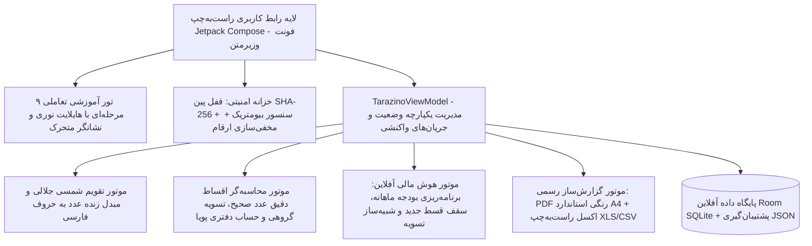

# ترازینو (Tarazino) `v0.1` — سامانه جامع آفلاین مدیریت اقساط، بدهی، وام و هوش مالی شخصی

**Tarazino (ترازینو)** نسخه `0.1` یک اپلیکیشن بومی اندروید (Kotlin + Jetpack Compose + Room SQLite) و ۱۰۰٪ آفلاین برای مدیریت دقیق اقساط بانکی، پلتفرم‌های خرید اعتباری (BNPL مانند اسنپ‌پی و دیجی‌پی)، قرض‌های شخصی، چک‌های صیادی و تحلیل هوشمند سلامت مالی ویژه کاربران فارسی‌زبان است.

---

## دانلود مستقیم فایل نصبی اندروید (Release `v0.1` — APK)

### ۱. دانلود مستقیم از بخش Releases در گیت‌هاب (GitHub Releases)
این مخزن مجهز به پایپ‌لاین خودکار انتشار گیت‌هاب (`.github/workflows/release-apk.yml`) است:
- به محض انتقال پروژه به گیت‌هاب (**Push to GitHub** از منوی بالای محیط Google AI Studio) یا ثبت تگ `v0.1`، سرویس **GitHub Actions** به صورت خودکار فایل نصبی امضاشده **`Tarazino-v0.1.apk`** را کامپایل کرده و در بخش **Releases** مخزن گیت‌هاب شما تحت عنوان **«ترازینو نسخه ۰.۱ (Tarazino v0.1) — انتشار رسمی اندروید (APK)»** منتشر می‌کند.
- کاربران می‌توانند مستقیماً وارد بخش **Releases** در صفحه اصلی مخزن گیت‌هاب شده و فایل **`Tarazino-v0.1.apk`** را از قسمت **Assets** با لینک مستقیم دانلود و روی گوشی اندرویدی خود نصب کنند.
- یادداشت‌های کامل این نسخه در فایل [`RELEASE_NOTES_v0.1.md`](./RELEASE_NOTES_v0.1.md) قرار دارد.

### ۲. دریافت مستقیم APK از داخل محیط Google AI Studio
- همچنین در محیط Google AI Studio می‌توانید از منوی تنظیمات/خروجی در بالای صفحه گزینه **Download APK / Export APK** را انتخاب کنید تا فایل نصبی `v0.1` مستقیماً دانلود شود.

---

## معماری سیستم (System Architecture)



---

## امکانات کلیدی نسخه `0.1` (Key Features)

1. **تور آموزشی تعاملی با هایلایت نوری المان‌ها و نشانگر متحرک (`InteractiveOnboardingTour`)**:
   - حرکت خودکار بین ۴ تب برنامه، اسکرول خودکار به المان هدف (`Auto-Scroll`)، برش نوری درخشان دور دکمه یا کارت هدف (`Spotlight Cutout`) و نشانگر گرافیکی متحرک در اولین اجرا (با امکان بازپخش در هر زمان از نوار بالا).
2. **مدیریت درختی پوشه اقساط و طرف‌حساب‌ها (`TreePortfolioScreen`)**:
   - سازماندهی درختی در ۴ پوشه اصلی (**پلتفرم‌های خرید اقساطی مانند اسنپ‌پی و دیجی‌پی**، **بانک‌ها و تسهیلات**، **صندوق‌های خانگی و قرض‌الحسنه**، و **اشخاص حقیقی و چک‌های صیادی**).
   - **ویزارد ۳ مرحله‌ای ثبت خرید و وام** با جدول قابل ویرایش برای تنظیم دستی یا خودکار تاریخ شمسی و مبلغ تک‌تک اقساط.
   - **تسویه گروهی چند قسط با هم (Batch Settlement)** با انتخاب چندتایی اقساط و نمایش جمع کل به عدد و حروف فارسی.
   - **ویرایش سریع مشخصات پرونده وام** و فیلتر و مرتب‌سازی هوشمند اقساط بر اساس فوریت سررسید و مبلغ.
3. **داشبورد خلوت، نمودار حلقه‌ای و نوار اقدام سریع شناور (`DashboardScreen`)**:
   - کارت خلاصه وضعیت ماه جاری، **نمودار حلقه‌ای (Donut Chart)** سهم هر دسته‌بندی و رادار **۳ سررسید فوری** با دکمه‌های پرداخت تک‌کلیکی و یادآوری فردا (`Snooze`).
   - **نوار اقدام سریع شناور** در پایین تمامی صفحات برای ثبت خرید/وام جدید یا تسویه فوری‌ترین قسط با یک لمس.
4. **هوش مالی آفلاین، برنامه‌ریزی بودجه ماهانه و شبیه‌ساز تسویه زودهنگام (`IntelligenceScreen`)**:
   - **پنل برنامه‌ریزی بودجه ماهانه و محاسبه سقف مجاز اقساط جدید** بر اساس درآمد ماهانه و درصد هزینه‌های ضروری زندگی.
   - تحلیل نسبت اقساط به درآمد (DTI)، شناسایی دهه اوج فشار مالی در ماه شمسی، تقویم حرارتی ۳۰/۳۱ روزه ماه جاری، نمودار بار ۱۲ ماه آینده و مقایسه متقارن استراتژی‌های تسویه زودهنگام **بهمن (Debt Avalanche)** و **گلوله برفی (Debt Snowball)**.
5. **استودیو گزارش‌گیری و چاپ رسمی A4 PDF و اکسل راست‌به‌چپ (`ReportExportEngine`)**:
   - رندر مستقیم صفحات استاندارد A4 رنگی (`595×842 pt`) با هدر برندینگ، کارت‌های KPI، نمودار پیشرفت، جدول زبرا و کادر مهر و امضای طرفین، به همراه خروجی `.xls` رنگی راست‌به‌چپ و `.csv` مجهز به UTF-8 BOM (`\uFEFF`).
6. **خزانه امنیتی و شخصی‌سازی پوسته (`SecurityVaultEngine`)**:
   - قفل پین ۴/۶ رقمی با صفحه‌کلید شیشه‌ای فارسی و هش SHA-256، سنسور اثر انگشت بیومتریک، حالت مخفی‌سازی ارقام در محیط عمومی، ۳ پوسته رنگی (**زمرد شب**، **مرمر روشن**، **اقیانوس کبود**) و پشتیبان‌گیری کامل JSON.

---

## ساختار دایرکتوری پروژه (Directory Structure)

```text
├── .github/workflows/
│   └── release-apk.yml                    # پایپ‌لاین خودکار ساخت APK و انتشار نسخه v0.1 در GitHub Releases
├── RELEASE_NOTES_v0.1.md                  # یادداشت‌های رسمی انتشار نسخه ۰.۱ در گیت‌هاب
├── app/src/main/java/com/example/
│   ├── MainActivity.kt                    # نقطه ورود اصلی، نوار اقدام سریع شناور و کنترلر تور و قفل امنیتی
│   ├── core/
│   │   ├── JalaliCalendarEngine.kt        # موتور ریاضی تقویم شمسی، سال کبیسه و مدیریت انتهای ماه
│   │   ├── PersianCurrencyEngine.kt       # مبدل زنده عدد به حروف فارسی، فرمت تومان/ریال و محاسبه‌گر
│   │   └── SecurityVaultEngine.kt         # هش SHA-256 پین، بازیابی امنیتی و وضعیت بیومتریک
│   ├── data/
│   │   ├── TarazinoEntities.kt            # مدل‌های داده Room برای طرف‌حساب‌ها، تعهدات، اقساط و ریزتراکنش‌ها
│   │   ├── TarazinoDao.kt                 # کوئری‌های واکنشی Flow و تراکنش‌های دیتابیس
│   │   ├── TarazinoDatabase.kt            # پایگاه داده آفلاین SQLite
│   │   ├── TarazinoRepository.kt          # لایه مخزن داده، پشتیبان‌گیری JSON و تنظیمات بودجه و کاربر
│   │   └── SeedDataEngine.kt              # داده‌های نمونه واقعی اکوسیستم مالی ایران (اسنپ‌پی، دیجی‌پی، بانک‌ها)
│   ├── domain/
│   │   ├── InstallmentScheduleEngine.kt   # تولید جدول اقساط دقیق و بازمحاسبه حساب دفتری
│   │   ├── FinancialIntelligenceEngine.kt # تحلیل DTI، سقف قسط جدید، دهه‌های بحرانی و شبیه‌ساز تسویه
│   │   └── QaDiagnosticsEngine.kt         # موتور تست‌های واحد و یکپارچگی منطق مالی
│   ├── export/
│   │   └── ReportExportEngine.kt          # تولید فایل PDF استاندارد A4 رنگی، اکسل XLS راست‌به‌چپ و CSV
│   └── ui/
│       ├── TarazinoViewModel.kt           # مدیریت وضعیت کل برنامه، تسویه گروهی و گام‌های تور آموزشی
│       ├── components/
│       │   ├── A4ReportPreviewModal.kt    # پیش‌نمایش زنده برگه A4 رنگی و اشتراک‌گذاری/چاپ PDF و اکسل
│       │   ├── InteractiveOnboardingTour.kt # تور آموزشی ۹ مرحله‌ای با برش نوری Spotlight و نشانگر متحرک
│       │   ├── JalaliDatePickerModal.kt   # انتخابگر تقویم شمسی تعاملی با میانبرهای هوشمند
│       │   ├── MoneyInputField.kt         # فیلد مبلغ با چیپ‌های افزایش سریع و حروف‌نگار زنده
│       │   ├── SecurityLockOverlay.kt     # صفحه قفل پین شیشه‌ای و اسکنر اثر انگشت بیومتریک
│       │   └── StepByStepObligationWizard.kt # ویزارد ۳ مرحله‌ای ثبت وام/خرید با جدول اقساط قابل ویرایش
│       ├── screens/
│       │   ├── DashboardScreen.kt         # داشبورد خلاصه ماه، نمودار حلقه‌ای و ۳ سررسید فوری
│       │   ├── TreePortfolioScreen.kt     # نمای درختی پوشه‌ها، فیلتر/مرتب‌سازی، ویرایش سریع و تسویه گروهی
│       │   ├── IntelligenceScreen.kt      # برنامه‌ریزی بودجه ماهانه، تقویم حرارتی و شبیه‌ساز تسویه زودهنگام
│       │   └── ReportsAndSettingsScreen.kt # استودیو خروجی PDF/اکسل، تنظیمات پوسته، امنیت و پشتیبان‌گیری
│       └── theme/
│           ├── Color.kt                   # پالت‌های رنگی زمرد شب، مرمر روشن و اقیانوس کبود
│           ├── Theme.kt                   # سیستم تمینگ Material 3 با پشتیبانی مقیاس فونت
│           └── Type.kt                    # تایپوگرافی وزیرمتن (Vazirmatn)
```

---

## راهنمای بیلد و اجرای آفلاین (Build & Verification Commands)

- کامپایل و ساخت بسته نصبی اندروید (`v0.1`):
  ```bash
  gradle assembleDebug
  ```
- اجرای تست‌های واحد و Robolectric:
  ```bash
  gradle :app:testDebugUnitTest
  ```
