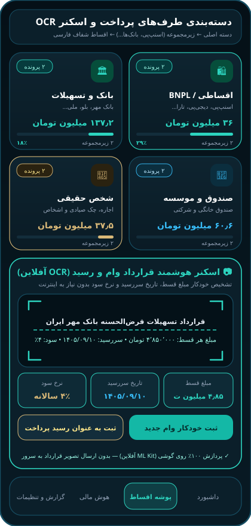
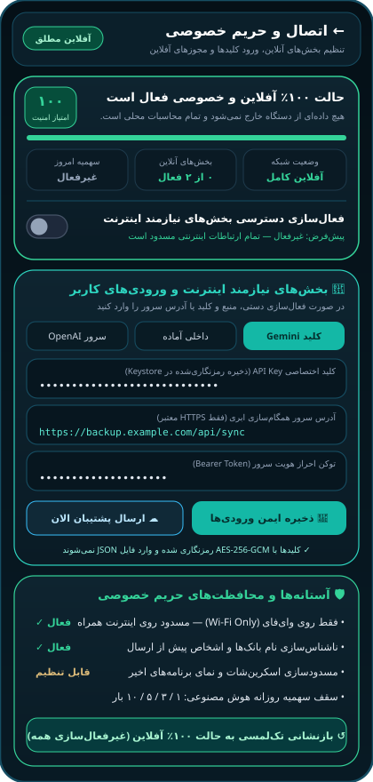
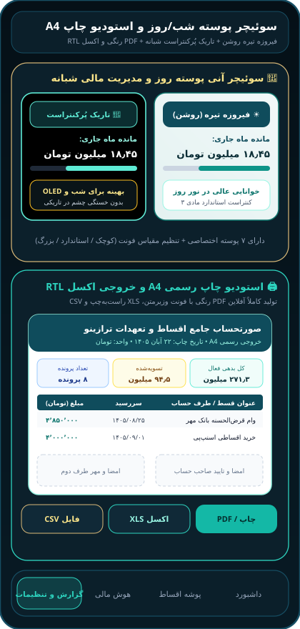
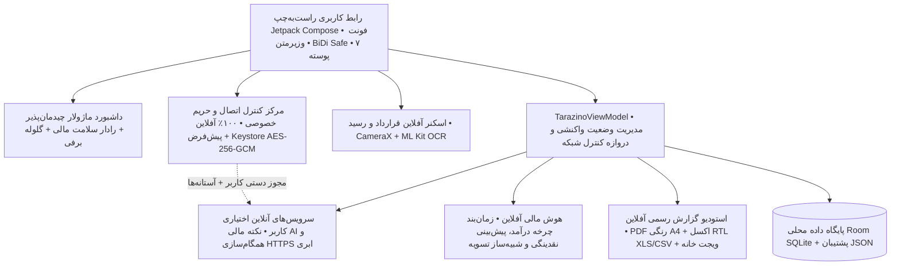

<div dir="rtl" align="right">

<p align="center">
  
</p>

<h1 align="center">ترازینو (Tarazino) — نسخه رسمی <code>v0.2</code></h1>
<h3 align="center">سامانه جامع، بومی و ۱۰۰٪ آفلاین (با اتصال اختیاری کاربر) برای مدیریت اقساط، بدهی، وام بانکی، پلتفرم‌های خرید اعتباری (اسنپ‌پی/دیجی‌پی)، چک صیادی، اسکنر OCR قرارداد و هوش مالی شخصی</h3>

---

## 📥 دانلود مستقیم فایل نصبی اندروید (`Tarazino-v0.2.apk`)

فایل نصبی کامپایل‌شده و امضاشده نسخه جدید **`0.2`** (همراه با آرشیو نسخه `0.1`) در پوشه [`/releases/`](./releases/) مخزن قرار گرفته و از طریق بخش **Releases** گیت‌هاب نیز قابل دریافت مستقیم است:

<table width="100%" dir="rtl">
  <thead>
    <tr>
      <th align="right">روش دریافت</th>
      <th align="right">توضیحات</th>
      <th align="center">لینک دانلود مستقیم</th>
    </tr>
  </thead>
  <tbody>
    <tr>
      <td align="right"><strong>۱. دانلود مستقیم و فوری نسخه جدید از مخزن (<code>v0.2</code>)</strong></td>
      <td align="right">فایل نصبی نهایی <code>Tarazino-v0.2.apk</code> (حجم ۶۹ مگابایت • اندروید ۷.۰ به بالا • شامل OCR آفلاین روی دستگاه) مستقیماً در پوشه <code>releases/</code> مخزن قرار دارد.</td>
      <td align="center"><a href="./releases/Tarazino-v0.2.apk"><strong>⬇ دانلود مستقیم Tarazino-v0.2.apk</strong></a></td>
    </tr>
    <tr>
      <td align="right"><strong>۲. دانلود از بخش Releases گیت‌هاب</strong></td>
      <td align="right">دریافت از صفحه رسمی انتشار (GitHub Releases) همراه با <a href="./RELEASE_NOTES_v0.2.md">یادداشت‌های انتشار نسخه <code>v0.2</code></a> و فایل چک‌سام <code>SHA-256</code>.</td>
      <td align="center"><a href="../../releases/latest/download/Tarazino-v0.2.apk"><strong>📦 صفحه Releases (نسخه v0.2)</strong></a></td>
    </tr>
    <tr>
      <td align="right"><strong>۳. کنترل سلامت فایل نصبی (<code>SHA-256</code>)</strong></td>
      <td align="right">کد هش استاندارد جهت اطمینان از صحت کامل بسته نصبی <code>v0.2</code> (<code>7e14fc072a15...24375d</code>).</td>
      <td align="center"><a href="./releases/Tarazino-v0.2.apk.sha256"><strong>🔐 مشاهده SHA-256</strong></a></td>
    </tr>
    <tr>
      <td align="right"><strong>۴. آرشیو نسخه قبلی (<code>v0.1</code>)</strong></td>
      <td align="right">فایل نصبی و یادداشت‌های انتشار نسخه نخست برای مقایسه یا بازگشت در صورت نیاز.</td>
      <td align="center"><a href="./releases/Tarazino-v0.1.apk"><strong>🗂 آرشیو Tarazino-v0.1.apk</strong></a></td>
    </tr>
  </tbody>
</table>

> **💡 نکته مهم درباره انتشار خودکار در Releases گیت‌هاب:**  
> فایل نصبی آماده **`releases/Tarazino-v0.2.apk`** مستقیماً در مخزن قرار گرفته و پایپ‌لاین [`.github/workflows/release-apk.yml`](./.github/workflows/release-apk.yml) بلافاصله پس از **Push to GitHub**، ریلیز رسمی **`v0.2`** را همراه با یادداشت‌های انتشار در بخش **Releases** منتشر می‌کند.

---

## ✨ تازه‌های نسخه ۰.۲ (`What's New in v0.2`)

- **مرکز کنترل «اتصال و حریم خصوصی» (۱۰۰٪ آفلاین پیش‌فرض + ورودی‌های کاربر):** تمامی قابلیت‌های نیازمند اینترنت به صورت پیش‌فرض غیرفعال هستند. کاربر در صورت تمایل می‌تواند هر بخش آنلاین (نکته مالی هوشمند یا همگام‌سازی ابری روی سرور شخصی) را فعال کرده، کلید API، نام مدل، آدرس امن HTTPS و توکن احراز هویت خود را به صورت رمزنگاری‌شده (`Android Keystore AES-256-GCM`) وارد کند و آستانه‌هایی نظیر **فقط روی وای‌فای**، **سقف سهمیه روزانه**، **ناشناس‌سازی داده** و **مسدودسازی اسکرین‌شات (`FLAG_SECURE`)** را مدیریت نماید.
- **اسکنر هوشمند قرارداد وام و رسید با دوربین (`CameraX + ML Kit OCR` آفلاین):** خواندن خودکار مبلغ قسط، تاریخ سررسید شمسی و نرخ سود از روی برگه‌های کاغذی به صورت کاملاً آفلاین روی گوشی برای پر کردن فوری ویزارد ثبت وام یا ثبت رسید پرداخت.
- **داشبورد ماژولار با قابلیت چیدمان و اولویت‌بندی (`Reorderable Grid`):** امکان جابه‌جایی، پین کردن به بالا، نمایش/مخفی‌سازی ماژول‌ها (مانند **رادار سلامت مالی ۵ بُعدی**، **ردیاب گلوله برفی بدهی** و **کارت نکته مالی روزانه**) و انتخاب چیدمان‌های آماده.
- **زمان‌بند خودکار بهترین روز پرداخت اقساط (در تب استراتژی):** تحلیل چرخه درآمدی کاربر برای پیشنهاد بهترین روز (یا دو روز) ماه شمسی جهت پرداخت یکپارچه اقساط.
- **سوئیچر آنی پوسته روشن فیروزه تیره و تاریک پُرکنتراست شبانه:** تغییر یک‌کلیکی بین پوسته روشن **فیروزه تیره (Deep Teal Light)** و **تاریک پُرکنتراست شبانه (High-Contrast Night Dark)** بهینه‌سازی‌شده برای مدیریت مالی در شب.
- **اصلاح جامع RTL / BiDi و خوانایی مبالغ فارسی:** ایزوله‌سازی کامل واژگان انگلیسی و اعداد در کنار جملات فارسی با کاراکترهای استاندارد Unicode BiDi و حذف کامل اختصار مبهم «م» به نفع عبارت‌های شفاف **«میلیون»** و **«میلیارد»**.

---

## 📱 گالری تصاویر جدید نسخه ۰.۲ (Updated Visual Screen Gallery)

### ۱. داشبورد ماژولار چیدمان‌پذیر و پوشه درختی اقساط + اسکنر قرارداد OCR

<table width="100%" dir="rtl">
  <thead>
    <tr>
      <th width="50%" align="center">داشبورد چیدمان‌پذیر، رادار سلامت مالی، گلوله برفی و کارت آفلاین AI</th>
      <th width="50%" align="center">دسته‌بندی درختی شفاف (بدون اختصار «م») و اسکنر آفلاین قرارداد (OCR)</th>
    </tr>
  </thead>
  <tbody>
    <tr>
      <td align="center">
        
      </td>
      <td align="center">
        
      </td>
    </tr>
    <tr>
      <td align="right">
        <ul>
          <li><strong>چیدمان ماژولار با قابلیت اولویت‌بندی:</strong> مرتب‌سازی، پین به بالا و نمایش/مخفی‌سازی ماژول‌های داشبورد بر اساس تمرکز مالی فعلی شما.</li>
          <li><strong>رادار سلامت مالی ۵ بُعدی و گلوله برفی:</strong> پایش لحظه‌ای نسبت بدهی به درآمد (<code>DTI</code>)، خوش‌حسابی، ذخیره پس‌انداز و پیشرفت حذف سریع بدهی‌ها.</li>
          <li><strong>کارت نکته مالی روزانه هوشمند (آفلاین پیش‌فرض):</strong> تا پیش از فعال‌سازی دستی کاربر، هیچ ترافیک اینترنتی ارسال نمی‌شود.</li>
          <li><strong>سوئیچر آنی پوسته و واحد پول:</strong> جابه‌جایی سریع بین پوسته شب/روز، تومان/ریال، مخفی‌سازی ارقام و قفل خزانه در نوار بالا.</li>
        </ul>
      </td>
      <td align="right">
        <ul>
          <li><strong>شفافیت کامل ارقام فارسی:</strong> نمایش دقیق مبالغ به صورت «میلیون تومان» و «میلیارد تومان» بدون اختصارهای مبهم و با پشتیبانی کامل <code>RTL/BiDi</code>.</li>
          <li><strong>اسکنر قرارداد وام و رسید (<code>OCR</code> آفلاین):</strong> استخراج مبلغ قسط، تاریخ شمسی و نرخ سود با دوربین گوشی بدون ارسال تصویر به سرور.</li>
          <li><strong>ساختار درختی ۴گانه و تسویه گروهی:</strong> تفکیک پوشه‌های خرید اقساطی (اسنپ‌پی/دیجی‌پی)، بانک‌ها، صندوق‌های خانگی و چک‌های صیادی.</li>
        </ul>
      </td>
    </tr>
  </tbody>
</table>

---

### ۲. زمان‌بند خودکار و استراتژی مالی، مرکز اتصال و حریم خصوصی، و پوسته‌ها / چاپ A4

<table width="100%" dir="rtl">
  <thead>
    <tr>
      <th width="33%" align="center">زمان‌بند خودکار، پیش‌بینی هوشمند و شبیه‌ساز تسویه</th>
      <th width="33%" align="center">مرکز کنترل «اتصال و حریم خصوصی» و ورود کلیدها</th>
      <th width="33%" align="center">سوئیچر پوسته شب/روز و استودیو چاپ رسمی A4</th>
    </tr>
  </thead>
  <tbody>
    <tr>
      <td align="center">
        
      </td>
      <td align="center">
        
      </td>
      <td align="center">
        
      </td>
    </tr>
    <tr>
      <td align="right">
        <ul>
          <li><strong>زمان‌بند خودکار چرخه درآمد:</strong> پیشنهاد بهترین روز (یا دو روز) ماه شمسی برای پرداخت اقساط با کمترین فشار نقدینگی.</li>
          <li><strong>هشدارهای پیش‌بینی با چیدمان BiDi بی‌نقص:</strong> شناسایی ماه‌های دارای کسری و محاسبه سقف ایمن افزودن قسط جدید.</li>
          <li><strong>شبیه‌ساز بهمن در برابر گلوله برفی:</strong> مقایسه دقیق تاریخ شمسی آزادی از بدهی و میزان صرفه‌جویی سود.</li>
        </ul>
      </td>
      <td align="right">
        <ul>
          <li><strong>پیش‌فرض ۱۰۰٪ آفلاین (Disabled):</strong> کلید اصلی دسترسی آنلاین و کلید مجزا برای هر قابلیت با بازگشت تک‌لمسی به حالت آفلاین مطلق.</li>
          <li><strong>ورود امن کلید و آدرس سرور توسط کاربر:</strong> انتخاب سرویس داخلی، کلید اختصاصی Gemini یا سرور OpenAI و سرور همگام‌سازی ابری HTTPS با رمزنگاری Keystore.</li>
          <li><strong>آستانه‌ها و سپرهای حفاظتی:</strong> محدودیت وای‌فای، سهمیه روزانه، ناشناس‌سازی داده، منع اسکرین‌شات و مخفی‌سازی مبالغ در ویجت.</li>
        </ul>
      </td>
      <td align="right">
        <ul>
          <li><strong>پوسته روشن فیروزه تیره و تاریک پُرکنتراست شبانه:</strong> بهینه‌سازی‌شده برای نمایشگرهای OLED و مطالعه طولانی شبانه همراه با ۷ پوسته اختصاصی.</li>
          <li><strong>استودیو گزارش رسمی A4 و اکسل RTL:</strong> خروجی آفلاین <strong>PDF رنگی A4</strong> با فونت وزیرمتن، <strong>اکسل راست‌به‌چپ (<code>.xls</code>)</strong> و <strong><code>.csv</code> استاندارد UTF-8 BOM</strong>.</li>
        </ul>
      </td>
    </tr>
  </tbody>
</table>

---

## 🏛️ معماری فنی سیستم (Clean Architecture — v0.2)



---

## 🛠️ جدول جامع ماژول‌ها و قابلیت‌های نسخه ۰.۲

<table width="100%" dir="rtl">
  <thead>
    <tr>
      <th align="right">کد ماژول</th>
      <th align="right">عنوان بخش</th>
      <th align="right">قابلیت‌های کلیدی پیاده‌سازی‌شده</th>
    </tr>
  </thead>
  <tbody>
    <tr>
      <td align="right"><code>MOD-01</code></td>
      <td align="right"><strong>موتور تقویم شمسی، BiDi و حروف‌نگار مبالغ</strong></td>
      <td align="right">الگوریتم کبیسه ۳۳ ساله جلالی، مبدل زنده عدد به حروف فارسی، ایزوله‌سازی کامل <code>RTL/BiDi</code> و نمایش شفاف مبالغ با «میلیون» و «میلیارد».</td>
    </tr>
    <tr>
      <td align="right"><code>MOD-02</code></td>
      <td align="right"><strong>پوشه درختی اقساط و اسکنر قرارداد OCR</strong></td>
      <td align="right">سازماندهی ۴گانه (خرید اقساطی، بانک، صندوق، اشخاص/چک صیادی)، تسویه گروهی، ویزارد ۳ مرحله‌ای و اسکن آفلاین قرارداد/رسید با CameraX و ML Kit.</td>
    </tr>
    <tr>
      <td align="right"><code>MOD-03</code></td>
      <td align="right"><strong>داشبورد ماژولار چیدمان‌پذیر و ویجت خانه</strong></td>
      <td align="right">قابلیت جابه‌جایی، پین کردن و نمایش/مخفی‌سازی ماژول‌ها (رادار سلامت مالی، گلوله برفی، نمودار دسته‌ها، نکته مالی) همراه با ویجت ثبت سریع صفحه اصلی.</td>
    </tr>
    <tr>
      <td align="right"><code>MOD-04</code></td>
      <td align="right"><strong>مرکز هوش مالی، زمان‌بند خودکار و پیش‌بینی</strong></td>
      <td align="right">پیشنهاد بهترین روز پرداخت ماه بر اساس چرخه درآمد، تحلیل <code>DTI</code>، سقف ایمن قسط جدید، تقویم حرارتی و شبیه‌ساز بهمن در برابر گلوله برفی.</td>
    </tr>
    <tr>
      <td align="right"><code>MOD-05</code></td>
      <td align="right"><strong>مرکز اتصال و حریم خصوصی (آفلاین پیش‌فرض)</strong></td>
      <td align="right">کلید اصلی آفلاین، فعال‌سازی دستی قابلیت‌های آنلاین با ورود کلید API و آدرس HTTPS توسط کاربر، رمزنگاری Keystore، محدودیت وای‌فای، سهمیه روزانه، ناشناس‌سازی و <code>FLAG_SECURE</code>.</td>
    </tr>
    <tr>
      <td align="right"><code>MOD-06</code></td>
      <td align="right"><strong>استودیو گزارش رسمی A4 PDF و اکسل RTL</strong></td>
      <td align="right">تولید کاملاً آفلاین برگه A4 رنگی با فونت وزیرمتن و کادر مهر و امضا، خروجی اکسل <code>.xls</code> راست‌به‌چپ و <code>.csv</code> مجهز به UTF-8 BOM.</td>
    </tr>
    <tr>
      <td align="right"><code>MOD-07</code></td>
      <td align="right"><strong>خزانه امنیتی، پین، بیومتریک و سوئیچر پوسته</strong></td>
      <td align="right">قفل پین <code>SHA-256</code>، احراز هویت بیومتریک، پوشش مخفی‌سازی ارقام و سوئیچر آنی بین پوسته روشن فیروزه تیره، تاریک پُرکنتراست شبانه و ۵ پوسته دیگر.</td>
    </tr>
  </tbody>
</table>

---

## 📂 ساختار دایرکتوری پروژه (Project Structure)

<div dir="ltr" align="left">

```text
├── .github/workflows/
│   └── release-apk.yml                         # پایپ‌لاین انتشار خودکار Tarazino-v0.2.apk در GitHub Releases
├── releases/
│   ├── Tarazino-v0.2.apk                       # فایل نصبی نهایی نسخه جدید ۰.۲ (آماده دانلود و نصب مستقیم)
│   ├── Tarazino-v0.2.apk.sha256                # کد کنترلی SHA-256 نسخه ۰.۲
│   ├── Tarazino-v0.1.apk                       # آرشیو فایل نصبی نسخه ۰.۱
│   └── Tarazino-v0.1.apk.sha256                # کد کنترلی نسخه ۰.۱
├── docs/screenshots/                           # تصاویر به‌روزرسانی‌شده نسخه ۰.۲
│   ├── 00_tarazino_hero_banner.svg
│   ├── 01_dashboard_rtl.svg
│   ├── 02_tree_portfolio_rtl.svg
│   ├── 03_intelligence_rtl.svg
│   ├── 04_connectivity_privacy_rtl.svg
│   └── 05_themes_and_a4_report_rtl.svg
├── RELEASE_NOTES_v0.2.md                       # یادداشت‌های رسمی انتشار نسخه ۰.۲
├── RELEASE_NOTES_v0.1.md                       # آرشیو یادداشت‌های نسخه ۰.۱
└── app/src/main/java/com/example/
    ├── MainActivity.kt                         # نقطه ورود اصلی، FLAG_SECURE، مسیریابی و لایه‌های امنیتی
    ├── ai/
    │   ├── AppCheckInitializer.kt              # پیکربندی App Check برای سرویس اختیاری داخلی
    │   ├── FirebaseAiFinancialTipService.kt    # اجرای اختیاری نکته مالی (داخلی / کلید Gemini / سرور OpenAI)
    │   └── RemoteCloudBackupSyncService.kt     # ارسال اختیاری پشتیبان JSON به سرور HTTPS کاربر
    ├── core/
    │   ├── JalaliCalendarEngine.kt             # موتور ریاضی تقویم شمسی جلالی ۳۳ ساله
    │   ├── PersianCurrencyEngine.kt            # حروف‌نگار مبالغ، ایزوله‌سازی BiDi و فرمت شفاف میلیون/میلیارد
    │   ├── LocalSecretVault.kt                 # خزانه رمزنگاری AES-256-GCM (Android Keystore) برای کلیدهای کاربر
    │   └── SecurityVaultEngine.kt              # هش SHA-256 پین، بازیابی امنیتی و بیومتریک
    ├── data/
    │   ├── TarazinoEntities.kt                 # مدل‌های پایگاه داده محلی Room
    │   ├── TarazinoDao.kt                      # کوئری‌های واکنشی Flow و تراکنش‌های SQLite
    │   ├── TarazinoDatabase.kt                 # پایگاه داده آفلاین دستگاه
    │   ├── TarazinoRepository.kt               # مخزن داده، تنظیمات حریم خصوصی و پشتیبان JSON
    │   └── SeedDataEngine.kt                   # داده‌های نمونه اکوسیستم مالی ایران
    ├── domain/
    │   ├── ConnectivityPrivacyEngine.kt        # قوانین حالت آفلاین، اعتبارسنجی HTTPS، سهمیه روزانه و ناشناس‌سازی
    │   ├── DailyAiFinancialTipEngine.kt        # ساخت خلاصه مخارج/بدهی و کش روزانه نکته مالی
    │   ├── DashboardLayoutGridEngine.kt        # موتور جابه‌جایی، پین و چیدمان ماژول‌های داشبورد
    │   ├── AutomatedPaymentSchedulerEngine.kt  # موتور پیشنهاد بهترین روز پرداخت ماه بر اساس چرخه درآمد
    │   ├── LoanContractOcrParser.kt            # استخراج مبلغ، تاریخ شمسی و سود از متن اسکن‌شده OCR
    │   ├── FinancialIntelligenceEngine.kt      # تحلیل DTI، سقف قسط جدید و شبیه‌ساز بهمن/گلوله برفی
    │   └── FinancialForecastMlEngine.kt        # پیش‌بینی آفلاین جریان نقدینگی و کسری ماه‌های آینده
    ├── export/
    │   └── ReportExportEngine.kt               # تولید آفلاین PDF رنگی A4، اکسل RTL و CSV
    ├── widget/
    │   └── TarazinoQuickLogWidgetProvider.kt   # ویجت صفحه اصلی با پشتیبانی مخفی‌سازی مبالغ
    └── ui/
        ├── TarazinoViewModel.kt                # مدیریت یکپارچه وضعیت و اعمال دروازه‌های اتصال/حریم خصوصی
        ├── components/                         # کارت نکته مالی، اسکنر OCR، رادار سلامت، چیدمان داشبورد و ویزارد
        ├── screens/
        │   ├── DashboardScreen.kt              # داشبورد چیدمان‌پذیر و تب استراتژی با زمان‌بند خودکار
        │   ├── TreePortfolioScreen.kt          # نمای درختی پوشه‌ها، فیلتر/مرتب‌سازی و تسویه گروهی
        │   ├── IntelligenceScreen.kt           # بودجه‌ریزی، پیش‌بینی هوشمند و شبیه‌ساز تسویه
        │   ├── ReportsAndSettingsScreen.kt     # استودیو A4/اکسل، پوسته، امنیت و ورود به اتصال و حریم خصوصی
        │   └── ConnectivityPrivacyScreen.kt    # صفحه متمرکز تنظیم بخش‌های آنلاین، ورود کلیدها و حریم خصوصی
        └── theme/                              # ۷ پوسته اختصاصی شامل فیروزه تیره روشن و تاریک پُرکنتراست شبانه
```

</div>

---

## ⚙️ راهنمای کامپایل و اجرای تست‌ها (Build & Test)

- **ساخت بسته نصبی اندروید (`APK`):**
  <div dir="ltr" align="left">

  ```bash
  gradle assembleDebug
  ```

  </div>

- **اجرای تست‌های واحد (`JVM Unit Tests`):**
  <div dir="ltr" align="left">

  ```bash
  gradle :app:testDebugUnitTest --tests "com.example.core.*" --tests "com.example.domain.*" --tests "com.example.ui.theme.*" --tests "com.example.export.*" --tests "com.example.widget.*"
  ```

  </div>

</div>
