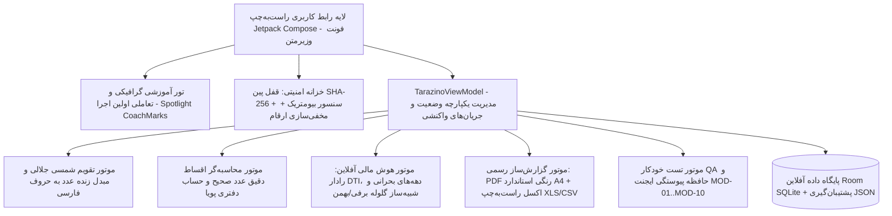

# ترازینو (Tarazino) — سامانه جامع آفلاین مدیریت اقساط، بدهی، وام و هوش مالی شخصی

**Tarazino (ترازینو)** یک اپلیکیشن بومی اندروید (Kotlin + Jetpack Compose + Room SQLite) و ۱۰۰٪ آفلاین برای مدیریت دقیق اقساط بانکی، پلتفرم‌های خرید اعتباری (BNPL مانند اسنپ‌پی و دیجی‌پی)، قرض‌های شخصی، چک‌های صیادی و تحلیل هوشمند سلامت مالی ویژه کاربران فارسی‌زبان است.

---

## معماری سیستم (System Architecture)



---

## امکانات کلیدی (Key Features)

1. **تور آموزشی گرافیکی و تعاملی در اولین اجرا (`InteractiveOnboardingTour`)**:
   - حرکت خودکار بین تب‌های برنامه همراه با کادرهای نورانی (Spotlight)، تصویرسازی گرافیکی و آموزش گام‌به‌گام بخش‌های مختلف در اولین اجرا (با امکان بازپخش در هر زمان).
2. **موتور تقویم شمسی (جلالی) ۱۰۰٪ بومی و مبدل زنده مبلغ به حروف فارسی (`MOD-01`)**:
   - تبدیل دوطرفه میلادی و شمسی بر اساس الگوریتم دقیق کبیسه ۳۳ ساله، مدیریت هوشمند انتهای ماه (`۳۱ شهریور` ← `۳۰ مهر` ← `۲۹/۳۰ اسفند`)، انتخابگر تقویم شمسی تعاملی و نمایش زنده معادل حروفی مبالغ به تومان و ریال.
3. **پرونده جامع طرف‌حساب‌ها (`MOD-02`)**:
   - دسته‌بندی بانک‌ها، پلتفرم‌های خرید اقساطی (BNPL)، صندوق‌های قرض‌الحسنه و اشخاص حقیقی، ذخیره شماره کارت ۱۶ رقمی با کپی آنی و شماره شبا (`IR`)، درجه حساسیت خوش‌حسابی (`حیاتی/قول شرف`، `بالا`، `عادی`) و خروجی مستقیم صورتحساب A4 PDF و اکسل برای هر طرف‌حساب.
4. **مدیریت اقساط، وام‌ها، چک صیادی و حساب دفتری موردی (`MOD-03`)**:
   - **حالت الف (جدول اقساط خودکار)**: محاسبه دقیق اقساط با ریاضیات عدد صحیح (`Long`) بدون حتی ۱ تومان خطای گرد کردن.
   - **حالت ب (حساب دفتری و خریدهای موردی)**: ثبت ریزخریدها و پرداخت‌های مرحله‌ای، ثبت پرداخت جزئی (`PARTIAL`)، جریمه دیرکرد، تخفیف تسویه زودهنگام و کد پیگیری.
5. **رادار هشدار سررسیدها و پرداخت سریع (`MOD-04`)**:
   - تفکیک خودکار تعهدات به `معوقه`، `سررسید امروز`، `نزدیک به سررسید` و `آینده` با وزن‌دهی اولویت اخلاقی/اعتباری، ثبت پرداخت تک‌کلیکی و یادآوری مجدد فردا (`Snooze`).
6. **هوش مالی آفلاین، تقویم حرارتی و شبیه‌ساز گلوله برفی در برابر بهمن (`MOD-05`)**:
   - تحلیل نسبت اقساط به درآمد (DTI)، شناسایی دهه اوج فشار مالی در ماه شمسی (دهه اول، دوم یا سوم)، نقشه حرارتی ۳۰/۳۱ روزه ماه جاری، نمودار بار ۱۲ ماه آینده و مقایسه تعاملی استراتژی‌های تسویه زودهنگام **گلوله برفی (Debt Snowball)** و **بهمن (Debt Avalanche)**.
7. **استودیو گزارش‌گیری و چاپ رسمی A4 PDF و اکسل راست‌به‌چپ (`MOD-06`)**:
   - رندر مستقیم صفحات استاندارد A4 رنگی (`595×842 pt`) با هدر برندینگ، کارت‌های KPI، نمودار پیشرفت، جدول زبرا و کادر مهر و امضای طرفین، به همراه خروجی `.xls` رنگی راست‌به‌چپ و `.csv` مجهز به UTF-8 BOM (`\uFEFF`).
8. **خزانه امنیتی، شخصی‌سازی تم و سوئیت تست خودکار QA (`MOD-07` .. `MOD-10`)**:
   - قفل پین ۴/۶ رقمی با صفحه‌کلید شیشه‌ای فارسی و هش SHA-256، سنسور اثر انگشت بیومتریک، حالت مخفی‌سازی ارقام در محیط عمومی، ۳ پوسته رنگی (**زمرد شب**، **مرمر روشن**، **اقیانوس کبود**)، پشتیبان‌گیری JSON و ۱۰ سوئیت تست خودکار درون‌برنامه‌ای.

---

## ساختار دایرکتوری پروژه (Directory Structure)

```text
app/src/main/java/com/example/
├── MainActivity.kt                        # نقطه ورود اصلی، تنظیمات RTL و کنترلر پوسته و قفل امنیتی
├── core/
│   ├── JalaliCalendarEngine.kt            # موتور ریاضی تقویم شمسی، سال کبیسه و مدیریت انتهای ماه
│   ├── PersianCurrencyEngine.kt           # مبدل زنده عدد به حروف فارسی، فرمت تومان/ریال و محاسبه‌گر
│   └── SecurityVaultEngine.kt             # هش SHA-256 پین، بازیابی امنیتی و وضعیت بیومتریک
├── data/
│   ├── TarazinoEntities.kt                # مدل‌های داده Room برای طرف‌حساب‌ها، تعهدات، اقساط و ریزتراکنش‌ها
│   ├── TarazinoDao.kt                     # کوئری‌های واکنشی Flow و تراکنش‌های دیتابیس
│   ├── TarazinoDatabase.kt                # پایگاه داده آفلاین SQLite
│   ├── TarazinoRepository.kt              # لایه مخزن داده، پشتیبان‌گیری JSON و تنظیمات کاربر
│   └── SeedDataEngine.kt                  # داده‌های نمونه واقعی اکوسیستم مالی ایران
├── domain/
│   ├── InstallmentScheduleEngine.kt       # تولید جدول اقساط دقیق و بازمحاسبه حساب دفتری
│   ├── FinancialIntelligenceEngine.kt     # تحلیل DTI، دهه‌های بحرانی، نقشه حرارتی و شبیه‌ساز تسویه
│   └── QaDiagnosticsEngine.kt             # اجرای خودکار ۱۰ سوئیت تست واحد و یکپارچگی
├── export/
│   └── ReportExportEngine.kt              # تولید فایل PDF استاندارد A4 رنگی، اکسل XLS راست‌به‌چپ و CSV
├── memory/
│   └── AgentMemoryLedger.kt               # دفتر کل حافظه کوتاه‌مدت ایجنت و تولید Snapshot پیوستگی
└── ui/
    ├── TarazinoViewModel.kt               # مدیریت وضعیت کل برنامه و رخدادهای تعاملی
    ├── components/
    │   ├── A4ReportPreviewModal.kt        # پیش‌نمایش زنده برگه A4 رنگی و اشتراک‌گذاری/چاپ PDF و اکسل
    │   ├── InteractiveOnboardingTour.kt   # تور آموزشی گرافیکی و تعاملی گام‌به‌گام در اولین اجرا
    │   ├── JalaliDatePickerModal.kt       # انتخابگر تقویم شمسی متحرک با میانبرهای هوشمند
    │   ├── MoneyInputField.kt             # فیلد مبلغ با چیپ‌های افزایش سریع و حروف‌نگار زنده
    │   └── SecurityLockOverlay.kt         # صفحه قفل پین شیشه‌ای و اسکنر اثر انگشت بیومتریک
    ├── screens/
    │   ├── DashboardScreen.kt             # داشبورد فرماندهی، کارت‌های KPI و رادار سررسیدها
    │   ├── EntitiesScreen.kt              # مدیریت طرف‌حساب‌ها، پرونده جامع و خروجی صورتحساب
    │   ├── ObligationsScreen.kt           # مدیریت وام‌ها، اقساط، پرداخت جزئی و ریزتراکنش‌های دفتری
    │   ├── IntelligenceScreen.kt          # مرکز هوش مالی، تقویم حرارتی شمسی و شبیه‌ساز تسویه زودهنگام
    │   └── ReportsAndSettingsScreen.kt    # مرکز گزارش‌گیری A4، تنظیمات تم/امنیت، حافظه ایجنت و تست QA
    └── theme/
        ├── Color.kt                       # پالت‌های رنگی زمرد شب، مرمر روشن و اقیانوس کبود
        ├── Theme.kt                       # سیستم تمینگ Material 3 با پشتیبانی مقیاس فونت
        └── Type.kt                        # تایپوگرافی وزیرمتن (Vazirmatn)
```

---

## راهنمای بیلد و اجرای آفلاین (Build & Verification Commands)

- کامپایل و ساخت بسته نصبی اندروید:
  ```bash
  gradle assembleDebug
  ```
- اجرای تست‌های واحد JVM:
  ```bash
  gradle :app:testDebugUnitTest
  ```
